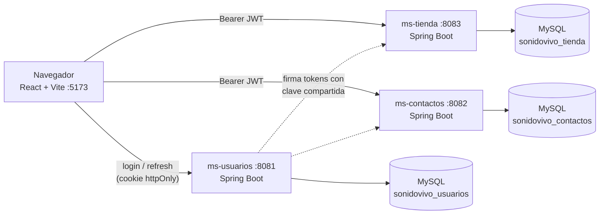
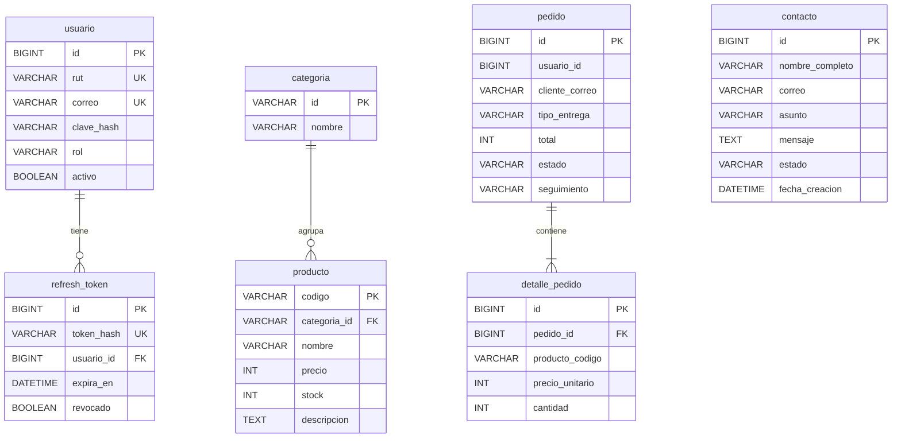
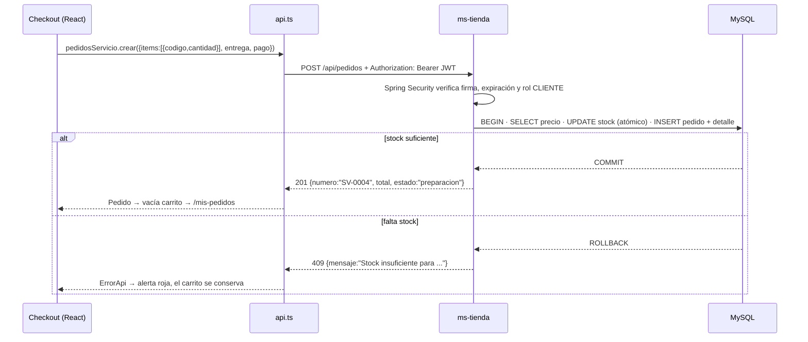
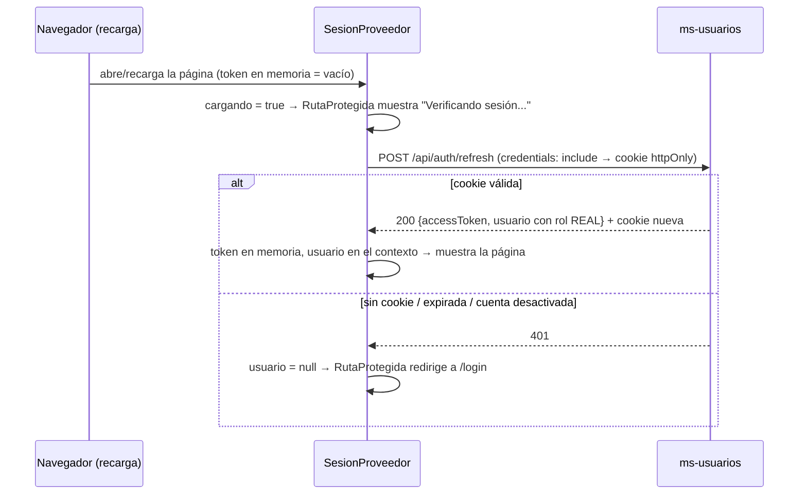

# Documento de integración — Sonido Vivo
**DSY1104 Desarrollo Fullstack II · Evaluación Parcial 3 · Duoc UC**
Integrante: Nicolás Rojas · Repositorios: frontend `https://github.com/Nicolas-Rojas1125/sonido-vivo` · backend `<agregar enlace>`

---

## 1. Arquitectura

| Microservicio | Responsabilidad | Tablas (Flyway) |
|---|---|---|
| **ms-usuarios** (8081) | Autenticación JWT (login, registro, renovación, cierre de sesión) y gestión de usuarios/roles | `usuario`, `refresh_token` |
| **ms-tienda** (8083) | Catálogo, inventario y pedidos. Productos y pedidos van juntos porque una compra debe descontar stock **en la misma transacción** | `categoria`, `producto`, `pedido`, `detalle_pedido` |
| **ms-contactos** (8082) | Mensajes del formulario de contacto | `contacto` |

Cada microservicio tiene **su propia base de datos** (es dueño de sus datos). Por eso `pedido.usuario_id` no tiene clave foránea hacia `usuario`: el id viene del token.

Capas en cada microservicio: **Controller** (endpoints REST + Swagger) → **Service** (lógica de negocio, `@Transactional`) → **Repository** (`JpaRepository`) → **Model** (entidades JPA). Además: `config/` (seguridad, JWT, CORS, Swagger, manejo de errores) y `dto/` (lo que entra y sale de la API, con validaciones).

---

## 2. Backend conectado a base de datos (IE3.1.1)

### 2.1 Modelo de datos

### 2.2 Migraciones Flyway
`spring.jpa.hibernate.ddl-auto=validate`: Hibernate **no** crea tablas, solo valida que coincidan con las entidades. Las crea Flyway, que registra en `flyway_schema_history` las versiones aplicadas.

| Servicio | Migraciones |
|---|---|
| ms-usuarios | V1 tabla usuario · V2 tabla refresh_token · V3 usuarios de prueba (claves BCrypt) |
| ms-tienda | V1 categoria + producto · V2 índice por categoría (ejemplo de modificación) · V3 catálogo de 51 productos · V4 pedido + detalle_pedido · V5 pedidos de ejemplo |
| ms-contactos | V1 tabla contacto · V2 columna estado |

### 2.3 Lógica de negocio que resuelve requisitos del cliente

| Requisito del caso | Implementación |
|---|---|
| Stock real; no vender lo que no hay | `ProductoRepository.descontarStock`: `UPDATE producto SET stock = stock - :c WHERE codigo = :cod AND stock >= :c`. Es **atómico**: dos compras simultáneas nunca dejan stock negativo. Si un producto no alcanza → 409 y `@Transactional` deshace todo (ni pedido ni stock a medias) |
| Precios confiables | El pedido solo recibe código y cantidad. El **precio lo pone el servidor** desde la BD (aunque alguien envíe `"precio": 1`, se ignora — probado) |
| Despacho o retiro | Despacho exige dirección y comuna y cobra $5.990; retiro exige un punto válido (`tienda`, `santiago-centro`, `las-condes`) y es gratis |
| Cada cliente ve solo sus pedidos | `GET /api/pedidos/mios` filtra por el `uid` del token (no por un parámetro que se pueda cambiar) |
| Estados del pedido + seguimiento | `preparacion → despachado → entregado` con N° Starken/Chilexpress (Vendedor/Administrador) |
| Cuentas y roles | RUT validado con módulo 11 también en el backend, correo y RUT únicos, contraseña segura, cuentas que se **desactivan** (no se borran: conservan su historial) |
| Resumen para el dueño | `GET /api/pedidos/resumen` con `GROUP BY estado` en la BD |

---

## 3. API REST y Swagger (IE3.2.1)

Todos los endpoints están documentados con `springdoc-openapi` (`@Tag`, `@Operation`) en **`/swagger-ui.html`** de cada microservicio, con botón **Authorize** para probarlos con el JWT.

### ms-usuarios (8081)
| Método | Ruta | Acceso | Respuestas |
|---|---|---|---|
| POST | `/api/auth/login` | Público | 200 · 401 · 403 (cuenta desactivada) |
| POST | `/api/auth/registro` | Público (crea CLIENTE) | 201 · 400 · 409 |
| POST | `/api/auth/refresh` | Cookie `sv_refresh` | 200 · 401 |
| POST | `/api/auth/logout` | Cookie `sv_refresh` | 204 |
| GET | `/api/auth/yo` | Con token | 200 · 401 |
| GET | `/api/usuarios` · `/api/usuarios/{id}` | ADMINISTRADOR | 200 · 403 · 404 |
| POST | `/api/usuarios` | ADMINISTRADOR | 201 · 400 · 409 |
| PUT | `/api/usuarios/{id}` | ADMINISTRADOR | 200 · 400 · 404 · 409 |
| PATCH | `/api/usuarios/{id}/estado` | ADMINISTRADOR | 200 · 400 |

### ms-tienda (8083)
| Método | Ruta | Acceso | Respuestas |
|---|---|---|---|
| GET | `/api/productos` · `/api/productos/{codigo}` · `/api/categorias` | **Público** (invitado incluido) | 200 · 404 |
| POST | `/api/productos` | ADMINISTRADOR | 201 · 400 · 409 |
| PUT | `/api/productos/{codigo}` | ADMINISTRADOR | 200 · 400 · 404 |
| DELETE | `/api/productos/{codigo}` | ADMINISTRADOR | 204 · 404 |
| PATCH | `/api/productos/{codigo}/stock` | ADMINISTRADOR, VENDEDOR | 200 · 400 |
| POST | `/api/pedidos` | CLIENTE | 201 · 400 · 409 (sin stock) |
| GET | `/api/pedidos/mios` | CLIENTE | 200 |
| GET | `/api/pedidos` · `/api/pedidos/resumen` | ADMINISTRADOR, VENDEDOR | 200 · 403 |
| GET | `/api/pedidos/{id}` | Dueño del pedido o personal | 200 · 403 · 404 |
| PUT | `/api/pedidos/{id}/estado` | ADMINISTRADOR, VENDEDOR | 200 · 400 · 404 |

### ms-contactos (8082)
| Método | Ruta | Acceso | Respuestas |
|---|---|---|---|
| POST | `/api/contactos` | **Público** (invitado incluido) | 201 · 400 |
| GET | `/api/contactos` · `/api/contactos/{id}` | ADMINISTRADOR, VENDEDOR | 200 · 404 |
| PUT | `/api/contactos/{id}/atendido` | ADMINISTRADOR, VENDEDOR | 200 · 404 |
| DELETE | `/api/contactos/{id}` | ADMINISTRADOR, VENDEDOR | 204 · 404 |

**Formato de errores (igual en los 3 servicios):** `{ "mensaje": "texto para el usuario", "errores": { "campo": "detalle" } }`. El frontend muestra `mensaje` directamente en las alertas.

---

## 4. Integración frontend ↔ backend (IE3.2.2)

### 4.1 Piezas del frontend
| Archivo | Rol |
|---|---|
| `src/servicios/api.ts` | Cliente HTTP único: agrega `Authorization: Bearer`, renueva el token ante un 401 y reintenta, convierte errores en `ErrorApi` con el mensaje del backend, y avisa si no hay conexión |
| `src/servicios/authServicio.ts` | Login, registro, refresh (una sola renovación a la vez) y logout contra ms-usuarios |
| `productosServicio.ts`, `pedidosServicio.ts`, `usuariosServicio.ts`, `contactosServicio.ts` | Una función por endpoint |
| `src/servicios/useCargar.ts` | Hook para cargar datos al abrir una página: estados *cargando / error / datos* y `recargar()` |
| `src/componentes/moleculas/EstadoCarga.tsx` | Muestra "Cargando…" o el error con botón **Reintentar** |

### 4.2 Flujo de una compra

### 4.3 Decisiones para un flujo de datos eficiente
- **Una petición por pantalla**: el catálogo se pide una vez y los **filtros, búsqueda y orden se aplican en el navegador** (sin una petición por cada tecla).
- **Peticiones en paralelo**: el resumen del panel pide ventas y catálogo con `Promise.all`.
- **Recarga solo tras cambios**: después de crear/editar/eliminar se vuelve a pedir la lista (`recargar()`), así la pantalla siempre refleja la BD.
- **Datos mínimos**: el carrito envía solo código y cantidad; los DTOs del backend nunca devuelven contraseñas ni hashes.
- **Consultas eficientes en el backend**: `@EntityGraph` trae pedido + detalle en una sola consulta (evita N+1); resumen con `GROUP BY` en MySQL; índice por categoría (V2).
- **Verificación sin consultas extra**: ms-tienda y ms-contactos validan el JWT **localmente** con la clave compartida, sin llamar a ms-usuarios en cada petición (stateless).
- **Renovación única**: si varias peticiones reciben 401 a la vez, comparten **una** renovación del token.
- **CORS**: solo se acepta el origen `http://localhost:5173` (configurable en `app.cors.origenes`).
- **Experiencia ante fallas**: estados de carga, botón Reintentar, botones deshabilitados mientras se procesa (sin doble envío), y los formularios no se borran si el servidor falla.

---

## 5. Autenticación con roles y JWT en el backend (IE3.3.1)

### 5.1 Tokens
| | Access token (JWT) | Refresh token |
|---|---|---|
| Formato | JWT firmado HS256 (Spring Security `NimbusJwtEncoder`) | 256 bits aleatorios (`SecureRandom`) |
| Contenido | `iss`=sonido-vivo, `sub`=correo, `uid`, `nombre`, `rol`, `iat`, `exp` | — (opaco) |
| Duración | 15 minutos | 7 días |
| Dónde viaja | Header `Authorization: Bearer …` | Cookie `sv_refresh` **HttpOnly, SameSite=Strict, Path=/api/auth** |
| Dónde se guarda en el servidor | En ningún lado (stateless) | Solo su **hash SHA-256** en la tabla `refresh_token` |

### 5.2 Generación, verificación y renovación segura
- **Generación** (`TokenService.generarAccessToken`): solo ms-usuarios tiene el `JwtEncoder`. La clave secreta tiene mínimo 32 caracteres (256 bits) y en producción se entrega con la variable de entorno `JWT_SECRETO`.
- **Verificación** (los 3 servicios): `oauth2ResourceServer().jwt()` con `NimbusJwtDecoder` comprueba **firma**, **expiración** y **emisor** en cada petición. Un token alterado o vencido → **401** (probado en `AuthIntegracionTest.tokenAlterado`).
- **Roles**: `JwtAuthenticationConverter` convierte el claim `rol` en `ROLE_ADMINISTRADOR`, `ROLE_VENDEDOR` o `ROLE_CLIENTE`; `SeguridadConfig` define `hasRole(...)` por ruta y método HTTP. Con token válido pero rol incorrecto → **403**.
- **Renovación con rotación** (`TokenService.consumirRefreshToken`): cada refresh token sirve **una sola vez**; al usarlo se revoca y se entrega uno nuevo. Si alguien reutiliza uno ya revocado (señal de robo), se **revocan todas las sesiones** de ese usuario.
- **Revocación**: logout revoca el refresh token; desactivar una cuenta o cambiarle el rol/clave cierra todas sus sesiones.
- **Contraseñas**: BCrypt (con sal, lento a propósito). El login responde el mismo mensaje si el correo no existe o si la clave es incorrecta, y compara contra un hash falso para no revelar qué correos existen.
- **Sin estado**: `SessionCreationPolicy.STATELESS`; CSRF deshabilitado porque la API usa Bearer (el único endpoint con cookie es refresh/logout, protegido por SameSite=Strict).

---

## 6. Gestión de sesión en el frontend (IE3.3.2)

- **Persistencia al recargar**: la sesión se recupera con el refresh token (cookie). El usuario no vuelve a escribir su clave durante 7 días.
- **Seguridad del estado**: el access token vive **solo en memoria** (`tokenEnMemoria` en `api.ts`), **nunca en localStorage** (un script malicioso no puede leerlo). La cookie es HttpOnly (JavaScript no la ve — verificado en Chrome). El **rol siempre viene del servidor**: editar el navegador para "darse" rol de administrador no sirve (prueba `contexto.spec.tsx`).
- **Expiración durante el uso**: si una petición recibe 401, `api.ts` renueva el token y repite la petición sin que el usuario lo note. Si no se puede renovar, se cierra la sesión y el login muestra *"Tu sesión expiró"*.
- **Cierre de sesión**: borra el token de memoria y llama a `/api/auth/logout`, que revoca el refresh token y borra la cookie.
- **Modo estricto de React / varias peticiones a la vez**: `authServicio.renovar()` comparte una sola petición de refresh, para no "gastar" dos veces el refresh token rotativo.

---

## 7. Restricciones de acceso en el frontend (IE3.3.3)

| Mecanismo | Dónde | Ejemplo |
|---|---|---|
| Rutas protegidas por rol | `RutaProtegida` en `App.tsx` | `/admin/usuarios` y `/admin/productos` solo Administrador; `/checkout` y `/mis-pedidos` solo Cliente; `/admin/*` Administrador y Vendedor |
| Acceso como **invitado** | `App.tsx`, `Navbar`, `Carrito` | Sin cuenta se puede ver la tienda (inicio, catálogo, detalle, nosotros, contacto) y armar el carrito. Para pagar, el carrito ofrece **Crear cuenta y comprar** o **Iniciar sesión**; después del registro/login vuelve directo a `/checkout` con el mismo carrito. Las vistas de Cliente y del Panel siguen redirigiendo a `/login` y vuelven a la página pedida |
| Menús según rol | `Navbar`, `LayoutAdmin` | El Cliente ve "Mis pedidos"; el Vendedor no ve "Productos" ni "Usuarios" en el panel |
| Acciones según rol | `Carrito` | El Vendedor ve el carrito pero no el botón "Continuar con la compra" |
| Destino tras login | `destinoTrasLogin` | Si un Vendedor venía de `/checkout`, se le envía a su panel en vez de "Acceso denegado" |
| Mientras se verifica | `RutaProtegida` | "Verificando sesión..." (no se muestra contenido protegido antes de confirmar el rol) |
| **Defensa en profundidad** | Backend | Aunque alguien saltara la interfaz, el backend responde 401/403 (prueba *"un VENDEDOR que intenta crear un producto recibe 403 del backend"*) |

---

## 8. Pruebas

| Tipo | Herramienta | Cantidad | Qué cubre |
|---|---|---|---|
| Unitarias/componentes frontend | Jasmine + Karma + Testing Library | **180** (cobertura 96 % sentencias) | Componentes, páginas, sesión JWT, renovación automática, restricciones por rol, servicios HTTP. Usan un **backend falso** (`src/test/backendFalso.ts`) que reproduce las reglas del servidor (401/403/409) |
| Integración backend | JUnit 5 + MockMvc + Spring Security Test, contra MySQL | **24** (ms-usuarios 11, ms-tienda 10, ms-contactos 3) | Catálogo y contacto públicos para el invitado, login, token alterado, 401/403 por rol, rotación del refresh token, logout, registro, CRUD de productos, compra con precio del servidor, stock "todo o nada", pedidos por cliente, contactos |
| Manuales | Swagger UI y Postman | 3 colecciones | Todos los endpoints con casos de éxito y de error |
